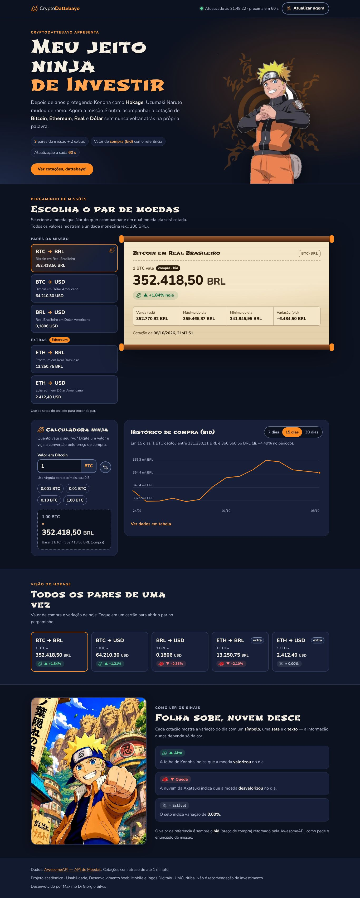

# Meu jeito ninja de Investir

> Aplicação web da **CryptoDattebayo** para o ex-Hokage **Uzumaki Naruto** acompanhar a cotação de
> **Bitcoin (BTC)**, **Ethereum (ETH)**, **Real (BRL)** e **Dólar (USD)** em tempo real.

**Disciplina:** Usabilidade, Desenvolvimento Web, Mobile e Jogos Digitais — UniCuritiba
**Aluno:** Maximo Di Giorgio Silva
**Tecnologias:** HTML5, CSS3 e JavaScript puros (sem framework, sem build, sem npm)
**Fonte dos dados:** [AwesomeAPI — API de Moedas](https://docs.awesomeapi.com.br/api-de-moedas)



---

## Sumário

1. [Como rodar](#1-como-rodar)
2. [O que a aplicação faz](#2-o-que-a-aplicação-faz)
3. [Estrutura de pastas](#3-estrutura-de-pastas)
4. [Como a API é usada](#4-como-a-api-é-usada)
5. [Arquitetura do JavaScript](#5-arquitetura-do-javascript)
6. [Usabilidade — heurísticas de Nielsen](#6-usabilidade--heurísticas-de-nielsen)
7. [Acessibilidade (WCAG 2.1)](#7-acessibilidade-wcag-21)
8. [Design visual](#8-design-visual)
9. [Verificação realizada](#9-verificação-realizada)
10. [Limitações e próximos passos](#10-limitações-e-próximos-passos)
11. [Créditos](#11-créditos)

---

## 1. Como rodar

**Opção A — Live Server (recomendado)**
1. Abra a pasta `meu-jeito-ninja-de-investir` no Visual Studio Code.
2. Instale a extensão **Live Server** (o VS Code sugere sozinho — ver `.vscode/extensions.json`).
3. Clique com o botão direito em `index.html` → **Open with Live Server**.

**Opção B — abrir direto**
Dê dois cliques em `index.html`. Funciona também, pois o projeto foi feito para rodar em `file://`
(scripts clássicos, sem `type="module"`, e ícones embutidos no CSS).

> É preciso estar **conectado à internet**: as cotações vêm da AwesomeAPI em tempo real.

**Dica:** o par escolhido fica no endereço. `index.html#BRL-USD` já abre com Real → Dólar.

---

## 2. O que a aplicação faz

| Área | O que mostra |
|------|--------------|
| **Cabeçalho** | Hora da última atualização, contagem regressiva para a próxima e botão "Atualizar agora". |
| **Seletor de pares** | Os 3 pares do enunciado (**BTC-BRL, BTC-USD, BRL-USD**) + 2 extras com Ethereum (ETH-BRL, ETH-USD). Cada opção já mostra o valor atual. |
| **Pergaminho de cotação** | `1 BTC vale 352.418,50 BRL` — valor de **compra (bid)**, variação do dia, venda (ask), máxima, mínima, variação absoluta e horário da cotação. |
| **Calculadora ninja** | Converte qualquer quantia pelo bid, nos dois sentidos (ex.: `200 BRL = 36,12 USD` ou o inverso). Tem atalhos de valores. |
| **Histórico** | Gráfico de linha do bid diário (7, 15 ou 30 dias) com tooltip, navegação por teclado e tabela de dados. |
| **Visão do Hokage** | Todos os 5 pares lado a lado; clicar abre o par no pergaminho. |
| **Como ler os sinais** | Legenda: folha de Konoha = alta · nuvem da Akatsuki = queda · selo = estável. |

**Regra do enunciado sempre respeitada:** todo valor monetário da tela passa pela função
`formatarValor()` (em `assets/js/format.js`), que devolve **número + código da moeda**
(`200,00 BRL`, `0,1806 USD`, `0,00284 BTC`). Não existe valor "solto" sem unidade.

---

## 3. Estrutura de pastas

```
meu-jeito-ninja-de-investir/
├── index.html                 ← página única (estrutura e textos)
├── README.md                  ← este arquivo
├── CHECKLIST.md               ← requisito do enunciado → onde foi atendido
├── .vscode/extensions.json    ← sugere o Live Server ao abrir no VS Code
├── docs/                      ← capturas de tela (desktop e celular)
├── assets/
│   ├── css/
│   │   ├── tokens.css         ← design tokens: TODAS as cores, fontes e espaços
│   │   ├── icones.css         ← folha e selo em SVG embutido (gerado por script)
│   │   └── style.css          ← layout e componentes (mobile-first)
│   ├── js/                    ← carregados nesta ordem pelo index.html
│   │   ├── config.js          ← pares, moedas, intervalos (só dados)
│   │   ├── format.js          ← formatação pt-BR + unidade; leitura do que é digitado
│   │   ├── api.js             ← ÚNICO arquivo que conversa com a AwesomeAPI
│   │   ├── chart.js           ← gráfico de linha em SVG, sem biblioteca
│   │   └── app.js             ← estado, renderização e eventos
│   └── img/
│       ├── naruto-hokage.webp ← recorte (fundo removido) da imagem fornecida
│       ├── naruto-vila.webp   ← arte da vila de Konoha
│       ├── nuvem-akatsuki.png ← nuvem recortada (ícone de QUEDA)
│       ├── folha-konoha.svg   ← símbolo vetorizado (ícone de ALTA e da marca)
│       ├── selo.svg           ← selo vetorizado (carregamento e ESTÁVEL)
│       └── favicon.png
└── tools/
    ├── gerar-icones.py        ← regenera icones.css a partir dos SVGs
    └── contraste.py           ← confere o contraste WCAG de todas as cores
```

---

## 4. Como a API é usada

### Endpoints

| Uso | Requisição |
|-----|------------|
| Cotação atual dos 5 pares (**1 requisição só**) | `GET https://economia.awesomeapi.com.br/json/last/BTC-BRL,BTC-USD,BRL-USD,ETH-BRL,ETH-USD` |
| Histórico diário de um par | `GET https://economia.awesomeapi.com.br/json/daily/BTC-BRL/15` |

### Exemplo de resposta (`/json/last/USD-BRL`)

```json
{
  "USDBRL": {
    "code": "USD", "codein": "BRL", "name": "Dólar Americano/Real Brasileiro",
    "high": "5.669", "low": "5.579", "varBid": "0.0373", "pctChange": "0.66",
    "bid": "5.6609",
    "ask": "5.6616", "timestamp": "1638386704", "create_date": "2021-12-01 16:25:04"
  }
}
```

- O valor de referência é o **`bid` (compra)**, como pede o enunciado.
- A API devolve números como **texto** (`"5.6609"`) — `api.js` converte com `parseFloat`.
- A chave do objeto é o par **sem hífen** (`USD-BRL` → `"USDBRL"`).
- Usamos **HTTPS** (o exemplo do enunciado está em `http://`, que o navegador bloquearia em
  páginas seguras por "conteúdo misto").

### Tratamento de erros

`api.js` transforma qualquer falha em um `ErroApi` com um **tipo**, e a tela mostra uma mensagem
específica para cada um:

| Tipo | Quando | Mensagem para o usuário |
|------|--------|-------------------------|
| `rede` | sem internet / API fora do ar | "Sem conexão com a internet ou a API está fora do ar…" |
| `tempo` | mais de 10 s sem resposta | "A API demorou demais para responder…" |
| `limite` | HTTP 429 | "Muitas consultas em pouco tempo. Aguarde um minuto…" |
| `nao-encontrado` | HTTP 404 (par inexistente) | Tenta **par a par** para salvar os que funcionam |
| `servidor` / `formato` | HTTP 5xx ou JSON inesperado | mensagens correspondentes |

Se já havia uma cotação na tela e a atualização falha, **a cotação antiga continua visível** com o
aviso "Sem conexão no momento — mostrando a última cotação recebida". Apagar tudo por causa de uma
falha momentânea seria pior para quem está acompanhando.

### Atualização automática

- A cada **60 segundos** (a API guarda o resultado em cache por 1 minuto para quem não usa chave,
  então atualizar mais rápido não traria dado novo — só gastaria requisições).
- A contagem **pausa quando a aba fica oculta** e retoma ao voltar.
- O histórico fica em cache por 10 minutos por par/período.

---

## 5. Arquitetura do JavaScript

### Padrão estado → render (o mesmo da Atividade 1)

```
evento (clique, digitação, resposta da API)
        │  só altera
        ▼
   objeto `estado`  ──►  render()  ──►  tela
```

1. Toda informação da tela mora em **um objeto `estado`** (`app.js`, seção 1).
2. Eventos **só alteram o estado**.
3. `render()` redesenha a tela a partir do estado.

Assim é impossível o pergaminho mostrar um par e a calculadora outro: os dois leem o mesmo
`estado.par`.

### Responsabilidade de cada arquivo

- **`config.js`** — só dados. Para incluir um par novo (ex.: `USD-BRL`), basta adicionar um objeto
  em `PARES`: seletor, painel geral, calculadora e gráfico se adaptam sozinhos.
- **`format.js`** — funções puras de formatação. Casas decimais por tipo de moeda: fiat com 2 casas
  (4 quando o valor é menor que 1, como `0,1806 USD`); cripto com até 8 casas (1 satoshi).
  `lerNumeroDigitado()` aceita `0,5`, `1.000`, `1.234,56` e `0.5`.
- **`api.js`** — único lugar com URLs; devolve objetos já limpos.
- **`chart.js`** — gráfico SVG feito à mão: linha de 2,5 px, grade discreta, mira + tooltip no
  mouse/toque, setas do teclado para percorrer os dias, redesenho ao redimensionar.
- **`app.js`** — estado, montagem inicial, funções `render*()`, ações e eventos.

### Por que scripts clássicos e não `import/export`?

Módulos ES (`type="module"`) **não funcionam** abrindo o arquivo direto (`file://`) — o navegador
bloqueia por CORS. Como o professor pode abrir o projeto com dois cliques, os scripts são clássicos e
carregados em ordem no fim do `<body>`.

---

## 6. Usabilidade — heurísticas de Nielsen

| # | Heurística | Como foi aplicada |
|---|-----------|-------------------|
| 1 | **Visibilidade do status do sistema** | Ponto colorido + "Atualizado às 21:43:51 · próxima em 42 s" no topo; selo girando enquanto carrega; `aria-busy` no pergaminho; botão "Atualizar agora" desabilita durante a busca. |
| 2 | **Correspondência com o mundo real** | Formato brasileiro (`352.418,50`), termos "compra" e "venda" ao lado de bid/ask, metáfora de pergaminho e de missão (o universo do usuário, Naruto). |
| 3 | **Controle e liberdade** | Trocar de par a qualquer momento; inverter a conversão; botão de atualizar manual; o par fica na URL (voltar/avançar do navegador funciona). |
| 4 | **Consistência e padrões** | Todo valor tem unidade, sempre no mesmo formato; o mesmo componente de variação (ícone + seta + texto) em todos os lugares; rádios nativos para uma escolha única. |
| 5 | **Prevenção de erros** | Campo com `inputmode="decimal"` (teclado numérico no celular); atalhos de valor; aceita vírgula ou ponto; a unidade fica colada ao campo para não haver dúvida da moeda. |
| 6 | **Reconhecer em vez de lembrar** | Cada opção de par mostra o nome por extenso e o valor atual; a calculadora lembra a cotação usada ("Base: 1 BTC = … BRL"). |
| 7 | **Flexibilidade e eficiência** | Setas do teclado trocam de par; link direto `#BTC-USD`; painel geral para quem quer ver tudo de uma vez. |
| 8 | **Estética e design minimalista** | O dado principal (bid) é o maior elemento da tela; dados secundários agrupados em uma grade discreta; tema Naruto aplicado sem competir com os números. |
| 9 | **Reconhecer e recuperar-se de erros** | Mensagens por tipo de erro em linguagem simples, botão "Tentar de novo", dado antigo mantido com aviso; validação do campo explica o formato esperado. |
| 10 | **Ajuda e documentação** | Dica de uso abaixo do campo e do seletor; seção "Como ler os sinais"; tabela de dados sob o gráfico; este README. |

---

## 7. Acessibilidade (WCAG 2.1)

- **Contraste:** 28/28 combinações de cor aprovadas (texto ≥ 4,5:1; contornos e gráficos ≥ 3:1).
  Rode `python tools/contraste.py` para conferir.
- **Cor não é a única informação (1.4.1):** variação = ícone (folha/nuvem/selo) + seta (▲▼=) + texto.
- **Teclado (2.1.1):** tudo funciona sem mouse. Rádios trocam com as setas; o gráfico recebe foco e
  as setas ←/→ percorrem os dias (Home/End vão às pontas, Esc fecha).
- **Foco visível (2.4.7):** anel amarelo de 3 px em todo elemento focável.
- **Pular conteúdo (2.4.1):** link "Pular para as cotações" é o primeiro item do Tab.
- **Leitores de tela:** região `aria-live` anuncia o novo par e o valor do dia no gráfico; o
  resultado da calculadora é um `<output>` com `aria-live`; erros do campo com `role="alert"` e
  `aria-invalid`; o gráfico tem descrição textual e **tabela equivalente** (1.1.1).
- **Alvos de toque:** botões com no mínimo 44 × 44 px.
- **Movimento (2.3.3):** com "reduzir movimento" ativado no sistema, as animações param.
- **Alto contraste do Windows:** ícones forçados para a cor do sistema (`forced-colors`).
- **Imagens:** decorativas com `alt=""` e `aria-hidden`; a arte da vila tem descrição.

---

## 8. Design visual

| Elemento | Escolha | Motivo |
|----------|---------|--------|
| Fundo | Azul-noite (`#0d1220`) | Konoha à noite; números claros se destacam |
| Cor de ação | Laranja (`#ff8a1f`) | O uniforme do Naruto |
| Cotação principal | Pergaminho bege com rolos de madeira | Metáfora de "missão"; maior contraste da tela fica no dado mais importante |
| Alta / queda | Folha de Konoha (verde) / nuvem da Akatsuki (vermelho) | Heróis sobem, vilões derrubam — fácil de lembrar |
| Títulos | Shojumaru (Google Fonts) | Traço de pincel, remete a caligrafia japonesa |
| Texto e números | Nunito com algarismos tabulares | Legível e os dígitos não "dançam" quando o valor muda |

Todas as cores estão em `assets/css/tokens.css`; nenhum outro arquivo escreve cor literal.

As imagens fornecidas foram tratadas com Python (Pillow/SciPy): fundo branco do Naruto e fundo
quadriculado da nuvem removidos; folha e selo **vetorizados** em SVG (nítidos em qualquer tamanho e
recoloríveis pelo CSS).

---

## 9. Verificação realizada

Testes automatizados no Chromium (Playwright) com a API simulada:

- Sem erros de JavaScript no console.
- Valor com unidade em todos os pares (`352.418,50 BRL`, `0,1806 USD`…).
- Calculadora: `200 BRL = 36,12 USD`, `1.000 BRL = 180,60 USD`, inversão e atalhos; texto inválido
  mostra erro.
- Setas do teclado trocam o par; o pergaminho acompanha.
- Período de 30 dias → 30 linhas na tabela; tooltip do gráfico via teclado e anúncio `aria-live`.
- Painel geral seleciona o par, move o foco e marca `aria-current`.
- API com erro 500: tela de erro sem dados; aviso de "desatualizado" com dados; recuperação ao
  "Tentar de novo".
- Carregamento: `aria-busy="true"` e selo girando.
- Link `#BTC-USD` abre o par certo.
- Sem rolagem horizontal em 380 px e 768 px.

---

## 10. Limitações e próximos passos

- A AwesomeAPI sem chave tem **cache de 1 minuto** e limite de uso. Para produção, cadastrar uma
  chave gratuita e enviá-la conforme a documentação.
- O endpoint `daily` traz um ponto por dia; para gráficos intradiários, usar
  `/BTC-BRL/100` (cotações sequenciais).
- Possíveis evoluções: alerta de preço, carteira do Naruto (quanto ele tem de cada moeda), modo
  claro.

---

## 11. Créditos

- **Dados:** [AwesomeAPI](https://docs.awesomeapi.com.br/api-de-moedas).
- **Personagens e símbolos:** *Naruto* © Masashi Kishimoto / Shueisha / Studio Pierrot. Imagens
  fornecidas pelo aluno e usadas apenas para fins acadêmicos, sem fins comerciais.
- **Fontes:** Shojumaru e Nunito — Google Fonts (licença SIL Open Font License).
- **Aviso:** projeto acadêmico. Não é recomendação de investimento.
